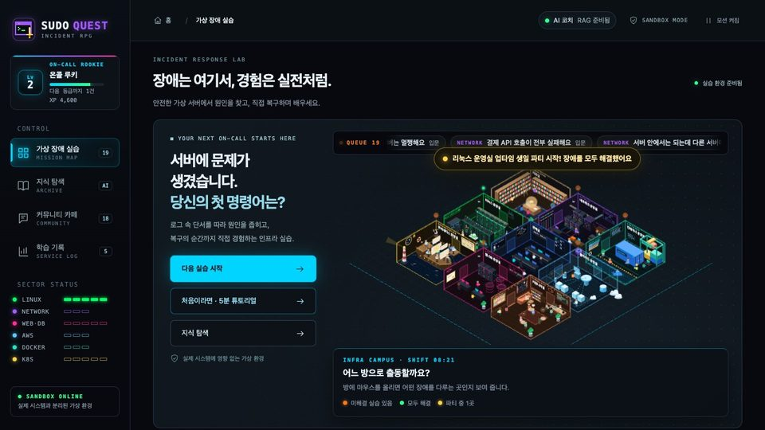
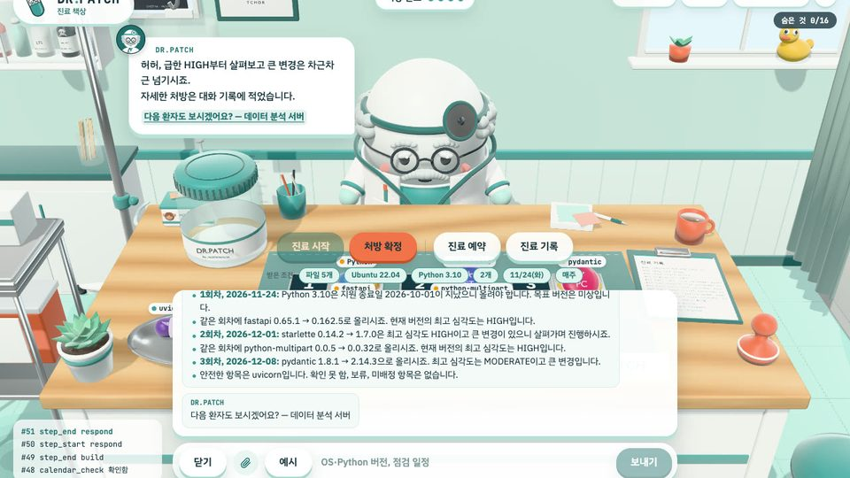

**IT 인프라 · 클라우드 엔지니어 지망 · SSAFY 16기**

장애를 재현하고 원인을 찾는 일, 그 과정을 도구로 만드는 일을 좋아합니다.

- **지금 집중** — 인프라 장애 대응 · AI Agent / RAG · Docker / AWS
- **자격증** — 정보처리기사 · 리눅스마스터 2급 · SQLD · ADsP

### Tech Stack

**Infra**&nbsp;&nbsp;    
**Backend · AI**&nbsp;&nbsp;       
**Frontend · App**&nbsp;&nbsp;    

### Projects

<table>
<tr>
<td width="50%" valign="top">

**[SUDO QUEST](https://github.com/ho0829-ui/sudo-quest)** 
브라우저에서 배우는 인프라 장애 대응 게임. 가상 CLI로 단서를 찾아 복구하는 24개 실습과 RAG AI 코치.

`React` `TypeScript` `FastAPI` `LangGraph`
</td>
<td width="50%" valign="top">

**[DR.PATCH](https://github.com/ho0829-ui/drpatch)** 
서버 패치·EOL 점검 플래너 Agent. 실제 EOL·취약점 데이터로 회차별 패치 계획을 세웁니다.

`FastAPI` `LangGraph` `Vue` `Three.js`
</td>
</tr>
</table>

| 프로젝트 | 내용 | 구분 |
|:--|:--|:--|
| [FOGO](https://github.com/ho0829-ui/driveatlas-FOGO) | 현대·기아 Pleos 공모전 차량용 앱 — 방문 장소 기록, 수집품 지도판 | 팀 · Kotlin |
| [장면 텍스트 VQA](https://github.com/ho0829-ui/ai-challenge-2) | SSAFY AI 챌린지 — 간판·메뉴판 4지선다, Public LB 0.974 | 팀 · Qwen3-VL |
| [멀티모달 AI 프록시](https://github.com/ho0829-ui/ssafy-pjt/tree/master/pjt_07) | Django 화면과 FastAPI Proxy를 분리하고 Guardrail · 라우팅 · 에러 처리를 거쳐 텍스트 · 이미지 · TTS 제공 | 2인 · 팀장, Proxy 담당 |
| [REST API 도서 커뮤니티](https://github.com/ho0829-ui/ssafy-pjt/tree/master/pjt_08) | DRF로 카테고리 · 도서 · 게시글 · 댓글 API를 설계하고 React 화면 연결 | 2인 · 도서 API · 화면 |
